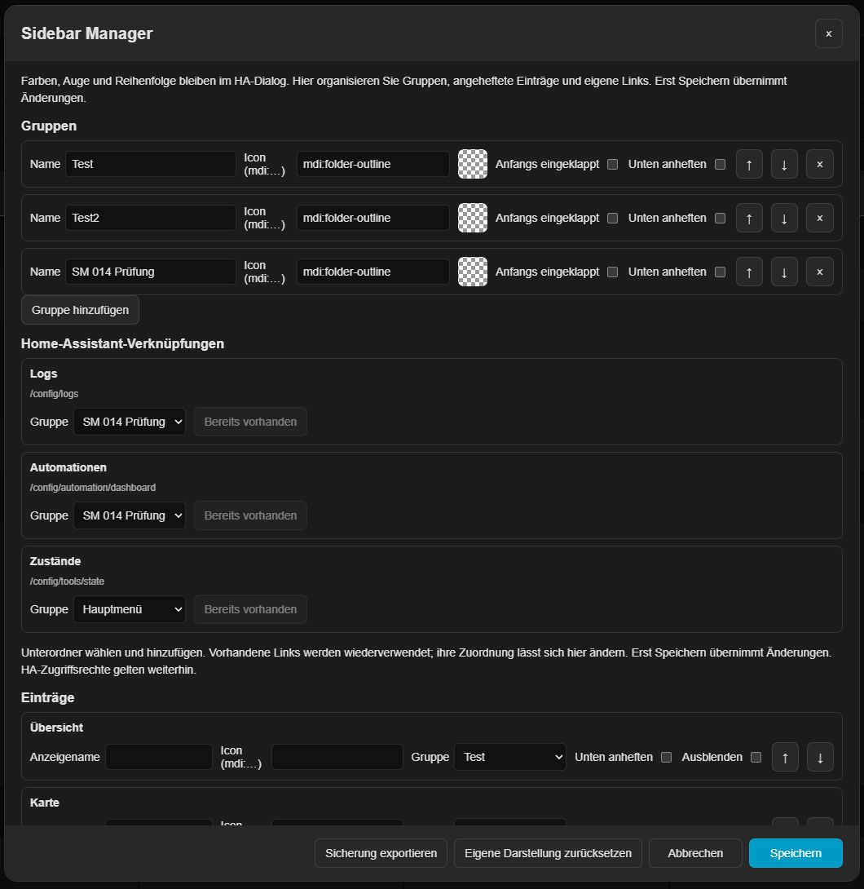
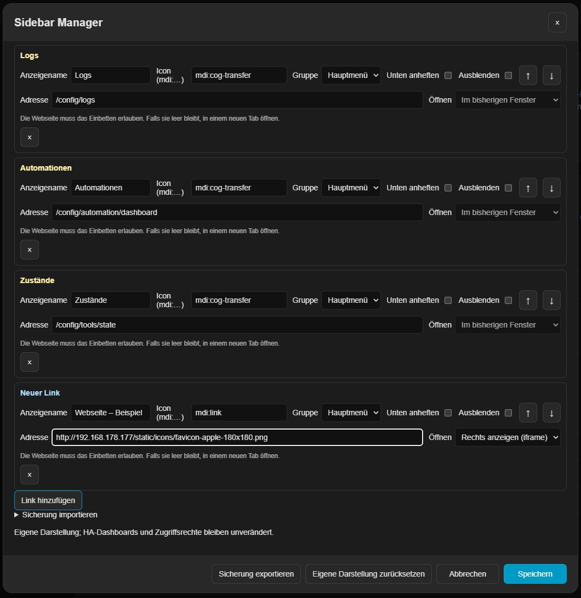
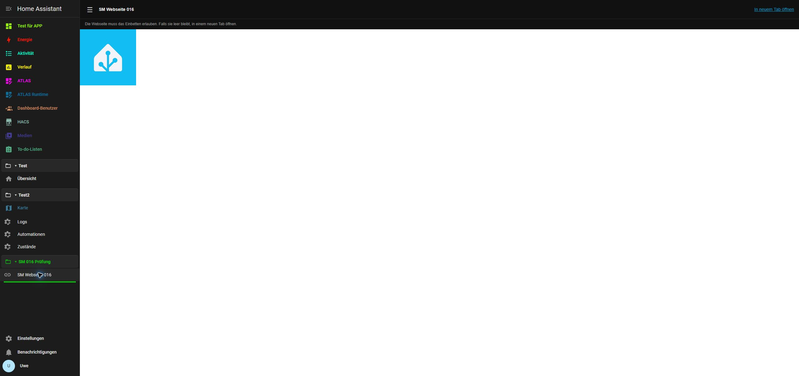

# Sidebar Manager 0.1.6 — local preview

[Deutsch](docs/README.de.md) · English · [Français](docs/README.fr.md)

One Home Assistant frontend extension for per-entry colors/opacity, groups, collapsible navigation, pinned entries and custom links. This is an unpublished local preview, intended for Home Assistant 2026.10.3 or newer; live verification is restricted to the authorized .177 test system.

## Use

Open Home Assistant's **Edit sidebar** dialog by holding the sidebar heading. The color fields, visibility controls and native ordering remain available. **Manage groups and links** opens Sidebar Manager. Its Save button commits the manager layout independently; color/order edits in the underlying HA dialog still require that dialog's Save button. Cancel discards the respective open draft.

Groups have a name, initial collapsed state and optional bottom placement. Existing items can be assigned to groups, renamed for display, given an MDI icon, hidden or pinned. Arrow buttons change custom layout order inside the Manager. Group headers can be collapsed with mouse, touch or keyboard. Pinned entries appear after normal entries within the scrollable main navigation, not in HA's protected profile/notification area. Own links accept internal paths and HTTP(S) URLs only. These presentation settings never change dashboard configuration or access permissions.

Folders have their own color picker with opacity, applied to the folder icon and name. **Theme color** clears the override. The Manager's Save button confirms the choice.

Each folder has a **Separator** slider from **0 to 4 px**. Zero switches it off. The line appears at the end of the folder's block, including when collapsed, in the folder icon's color and opacity. It adds only 1 px of spacing above and below. Empty folders have no separator.

Own internal links are marked pale yellow in settings; external HTTP(S) links are **light blue** (`#a8dcff`). External links can open in a **new tab** or **on the right inside HA (iframe)**. New links default to a new tab. Older links retain their previous same-window behavior until changed. These markers do not override individual sidebar colors or icons.

The native **Edit sidebar** dialog lists all folders together with the main entries. Use the same native drag handle to place any folder between main entries. There are no extra Up/Down buttons. The native keyboard sorting remains available (Alt+Up/Down on a row). Save commits the mixed order; Cancel discards it. Folder membership is unchanged, so a folder and its children move as one block in the sidebar. Pinned-bottom groups stay in the bottom section. Folder IDs never enter HA's stored native panel order.

## Storage and recovery

Every normal main-menu entry shows its group name or **Main menu** beside the color field. Click it to open the matching assignment directly. Choose a group or **Main menu** to move the entry back; this includes existing app and dashboard entries without changing their HA target. Each group has its own MDI icon, defaulting to an outlined folder. Settings, profile and notifications remain native.

- Existing Sidebar Colors settings remain under `ugso_sidebar_colors_v1`, without migration or reset.
- Layouts use `ugso_sidebar_manager_v1`, stored per authenticated HA user on the HA server and synchronized between clients.
- Missing panels remain in the record. They are never automatically deleted during loading.
- Read failures and unknown schemas do not write defaults. Concurrent changes are rejected before saving. Uncertain writes are read back, not automatically retried.
- A local previous-layout backup is required before writes; blocked storage prevents saving. The layout JSON export/import includes groups, labels, links, pinning, hiding and ordering. It does not contain access tokens or native HA settings. Colors retain their separate existing backup.
- Reset affects only the manager draft until saved. Native sidebar order, visibility and colors are retained.

## Local installation

Use only the new module, never alongside Sidebar Colors or Sidebar Organizer:

```yaml
frontend:
  extra_module_url:
    - /local/ugso-sidebar-manager/0.1.6/ha-sidebar-manager.js
```

Copy `dist/ha-sidebar-manager.js` to the matching directory under `/config/www`. Preserve existing frontend/themes configuration; replace the old colors module entry rather than duplicating `frontend`. Validate the HA configuration, restart HA and reload the browser. The previous module and configuration are retained in the PC backup for rollback.

For the iframe option, also merge the entry from **`panel-custom.example.yaml`** into `configuration.yaml` (or the existing `panel_custom` list). It registers the hidden `ugso-sidebar-web` panel without an extra sidebar entry. Keep its module URL identical to the frontend module URL. Validate and restart HA once. Without this registration, clicking an iframe link displays a setup notice. The panel reads only the signed-in user's saved links and never forwards HA tokens. The target website must allow embedding; CSP/X-Frame-Options and HTTPS-to-HTTP restrictions can prevent it. The panel always offers a new-tab alternative. An embedded third-party page retains that website's own login requirements.

This local package includes a HACS-style `hacs.json` and a bundled single JS file, but no GitHub repository or release has been created. No catalog inclusion is claimed.

## Development

The settings include shortcuts for Logs, Automations and States, each with a selectable folder and `mdi:cog-transfer`. Existing matching URLs are reused without overwriting their names or icons. Changes apply only after Save. States uses the current `/config/tools/state` route; legacy `/developer-tools/state` links are recognized. These links do not change HA access permissions.

The shortcut section heading and shortcut names are pale yellow (`#fff2a6`), including their names in the entry list below. This highlight affects only the settings dialog, not user-selected sidebar colors or editable icons.

Version 0.1.6 is installed and verified on .177 (HA 2026.10.4, port 80), with 56 automated tests. New-tab and embedded opening were checked with a resource on .177. The 4 px separator, matching opacity, collapse, reload persistence and switching off were verified. Temporary test objects were removed; existing settings and Test für APP were preserved. No external website compatibility is claimed. See `docs/TESTING.md`.







Node 22 or newer: `npm ci`, `npm run check`, `npm run build`, `npm test`.

Original implementation based on UGSo Sidebar Colors. Sidebar Organizer by Viet Ngoc is a behavioral reference; no Organizer source code is embedded. Its MIT license would require retaining the original copyright if source were adopted in a later increment.

## Limits

Native sidebar internals can change with HA updates. This preview deliberately leaves native ordering, hidden-panel preferences, settings/profile/notification entries, themes and permissions under HA control. There is no import of Organizer's YAML yet, no per-device layout overrides, and no user-defined CSS or template actions. Appearance/header/width options and automatic Organizer migration remain follow-up work. Pre-save checks are not a server-side compare-and-swap; a narrow simultaneous-write race remains possible.
