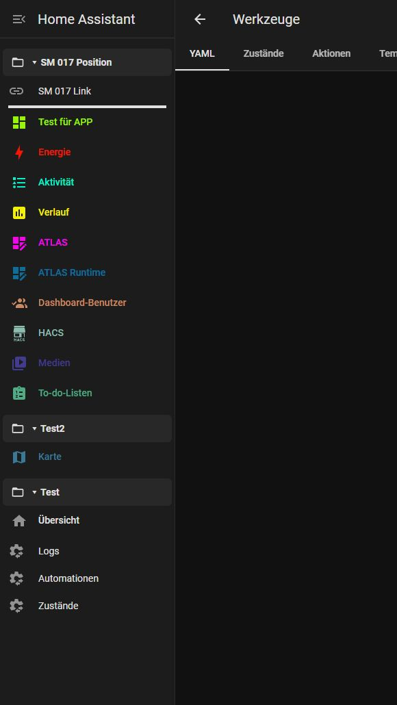
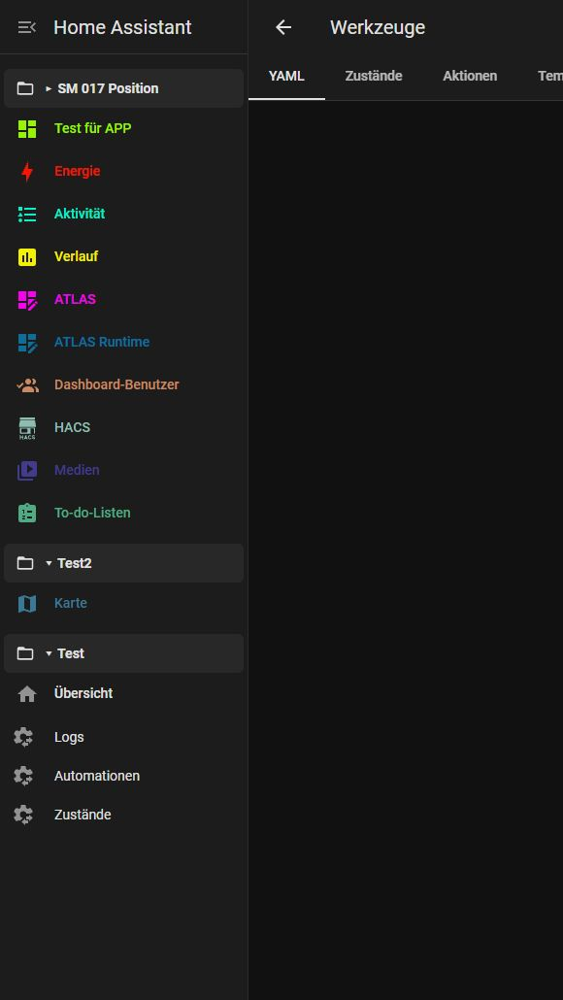
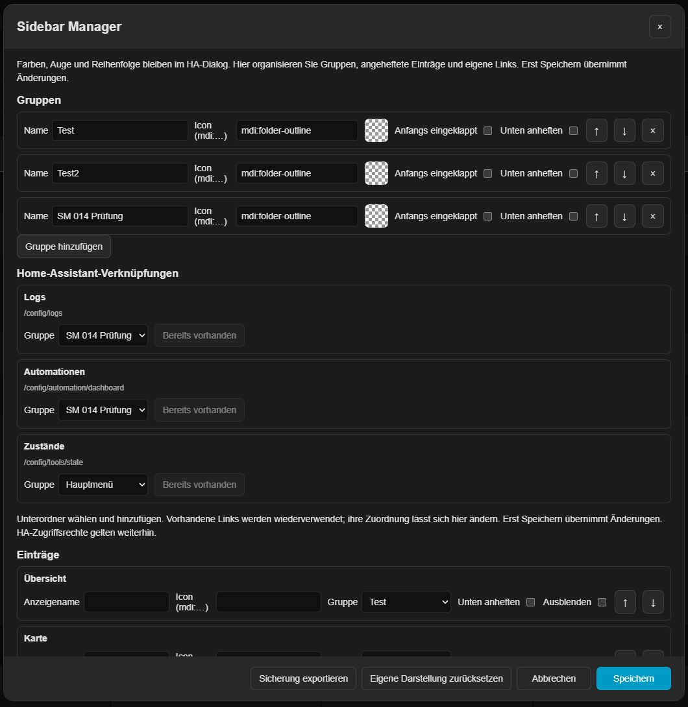
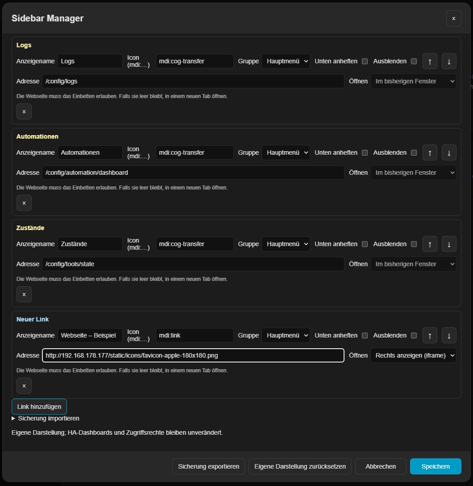
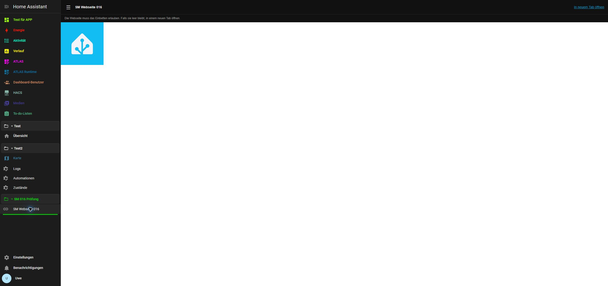

# Sidebar Manager 0.1.7 — lokale Vorschau

Eigenständige Erweiterung für Home Assistant: Farben und Transparenz, Gruppen, Ein-/Ausklappen, Anheften, eigene Links, Anzeigenamen und MDI-Icons. DE/EN/FR folgen automatisch der HA-Sprache. Noch nicht veröffentlicht.

0.1.7 ist auf .177 geprüft (HA 2026.10.4, Port 80): zunächst unten angehefteten Testordner verschoben, Abbrechen, Speichern und Neuladen geprüft. Trennlinien erscheinen nur ausgeklappt; 60 automatische Tests erfolgreich. Einstellungen und „Test für APP“ erhalten, eigene Testobjekte entfernt.

## Bedienung

Den Kopf der HA-Seitenleiste länger gedrückt halten. Im normalen Dialog „Seitenleiste bearbeiten“ bleiben Farbfelder, Augen und Sortieren erhalten. „Gruppen und Links verwalten“ öffnet den Manager. Dessen Speichern übernimmt die Organisation; Änderungen an Farben oder HA-Reihenfolge im darunterliegenden Dialog müssen dort zusätzlich gespeichert werden. Abbrechen verwirft den jeweiligen Entwurf.

Gruppen lassen sich benennen, anfangs einklappen und unten anordnen. Einträge können Gruppen zugeordnet, für die Anzeige umbenannt, mit MDI-Icons versehen, ausgeblendet und angeheftet werden. Pfeile ändern die eigene Reihenfolge innerhalb des Managers. Gruppenüberschriften lassen sich per Maus, Touch und Tastatur öffnen. Angeheftete Einträge stehen am Ende der scrollbaren Hauptnavigation, nicht im geschützten HA-Bereich für Profil und Benachrichtigungen. Links erlauben interne Pfade und HTTP(S).

Jede Gruppe hat einen Regler **Trennlinie von 0 bis 4 px**. Null bedeutet **Aus**. Die Linie steht nur bei ausgeklapptem Untermenü an dessen Ende, in Farbe und Transparenz des Ordner-Icons. Ober- und unterhalb bleiben jeweils nur 1 px Abstand. Leere oder eingeklappte Gruppen zeigen keine Linie.

Eigene interne Links erscheinen in den Einstellungen hellgelb, externe HTTP(S)-Links **hellblau** (`#a8dcff`). Für externe Links stehen **In neuem Tab öffnen** und **Rechts anzeigen (iframe)** zur Auswahl. Neue Links verwenden zunächst einen neuen Tab. Bestehende Links behalten ihre bisherige Öffnungsart, bis sie geändert wird. Eigene Seitenleistenfarben und Icons bleiben erhalten.

## Daten erhalten

Jeder normale Hauptmenüeintrag zeigt neben seinem Farbfeld den Gruppennamen oder „Hauptmenü“. Ein Klick öffnet direkt die passende Zuordnung. Im Manager wählen Sie unter „Gruppe“ einen Ordner oder „Hauptmenü“ für die Rückkehr. Auch bestehende App- und Dashboard-Einträge sind verschiebbar; das HA-Ziel bleibt gleich. Jede Gruppe hat ein eigenes MDI-Icon, standardmäßig einen Ordner. Die geschützten Einträge Einstellungen, Profil und Benachrichtigungen bleiben nativ.

Bestehende Farben bleiben unter `ugso_sidebar_colors_v1`. Die Organisation wird getrennt unter `ugso_sidebar_manager_v1` pro HA-Benutzer auf dem HA-Server gespeichert und zwischen Clients synchronisiert. Fehlende Menüeinträge bleiben gespeichert. Ladefehler und unbekannte Datenformate überschreiben niemals die Einstellungen mit Standardwerten. Vor jedem Schreiben wird lokal der vorherige Organisationsstand gesichert; bei blockiertem Browserspeicher wird nicht gespeichert. Konflikte werden vor dem Schreiben geprüft, verlorene Bestätigungen nachgelesen. Ein enges Restrisiko gleichzeitiger Schreibvorgänge bleibt ohne serverseitigen Versionsvergleich.

„Sicherung exportieren/importieren“ betrifft die Organisation (Gruppen, Links, Anzeigenamen, Icons, Ausblenden, Anheften, Reihenfolge), keine Zugangsdaten und keine nativen HA-Einstellungen. Die bisherigen Farben behalten ihre eigene Sicherung. „Eigene Darstellung zurücksetzen“ ändert zunächst nur den offenen Entwurf.

## Installation und Rückkehr

Nur ein Modul laden: `/local/ugso-sidebar-manager/0.1.7/ha-sidebar-manager.js`. Das neue Bundle liegt im entsprechenden Unterordner von `/config/www`. Vorhandene Themes und weitere Frontend-Einträge erhalten. Den alten Farbmodul-Eintrag ersetzen, keine zweite `frontend`-Sektion anlegen. Konfiguration prüfen, HA neu starten und Browser neu laden. Sidebar Colors und Sidebar Organizer nicht gleichzeitig mit Sidebar Manager laden.

Für die iframe-Auswahl zusätzlich den Eintrag aus **`panel-custom.example.yaml`** in `configuration.yaml` bzw. die vorhandene `panel_custom`-Liste übernehmen. Er registriert `ugso-sidebar-web` ohne zusätzlichen Seitenleisteneintrag. Die Moduladresse muss mit der Frontend-Moduladresse übereinstimmen. Einmal prüfen und HA neu starten. Ohne diese Registrierung erscheint beim Öffnen ein Einrichtungshinweis. Das Panel verwendet nur gespeicherte Links des angemeldeten Benutzers und übergibt keine HA-Tokens. Die Zielseite muss Einbettung erlauben; CSP/X-Frame-Options oder HTTPS-zu-HTTP können sie verhindern. Als Alternative bleibt „In neuem Tab öffnen“ verfügbar. Eine fremde Webseite benötigt weiterhin ihre eigene Anmeldung.

Ordner besitzen einen eigenen Farbwähler mit Transparenz. Die Farbe gilt für Icon und Gruppennamen. „Theme-Farbe“ entfernt die eigene Farbe; gespeichert wird erst mit dem Speichern im Manager.

Im nativen Dialog „Seitenleiste bearbeiten“ stehen alle Untermenüs gemeinsam mit den Haupteinträgen. Mit demselben Ziehgriff rechts lässt sich jeder Ordner zwischen Haupteinträge verschieben, ohne zusätzliche Pfeilbuttons. Die native Tastaturbedienung bleibt möglich (Alt+Auf/Ab auf einer Zeile). Speichern übernimmt die gemeinsame Reihenfolge; Abbrechen verwirft sie. Gruppenzuordnungen bleiben erhalten: In der Seitenleiste wandern Ordner und ihre Inhalte als Block. Unten angeheftete Ordner bleiben im unteren Bereich. Ordner-IDs gelangen niemals in die gespeicherte native HA-Panelliste.

Seit 0.1.7 stehen unten angeheftete Ordner auch im Editor unten. Wird ein solcher Ordner vor einen normalen Hauptmenüblock verschoben, hebt dies seine untere Anheftung auf. Die gespeicherte Position gilt damit auch in der tatsächlichen Seitenleiste. Abbrechen erhält ursprüngliche Position und Anheftung.

Für die Rückkehr den gesicherten alten Moduleintrag wiederherstellen und HA neu starten. Manager-Daten bleiben unter ihrem eigenen Schlüssel; die bisherigen Farben und nativen Einstellungen werden nicht verändert.

## Grenzen dieses ersten Stands

Unter „Home-Assistant-Verknüpfungen“ stehen Logs, Automationen und Zustände bereit, jeweils mit auswählbarem Unterordner und `mdi:cog-transfer`. Vorhandene passende Links werden wiederverwendet, eigene Namen und Icons erhalten. Erst Speichern übernimmt Änderungen. Zustände verwendet `/config/tools/state`; ältere Links auf `/developer-tools/state` werden erkannt. HA-Zugriffsrechte bleiben unverändert.

Die Überschrift und die drei Namen erscheinen hellgelb (`#fff2a6`), auch unten in der Eintragsliste. Diese Hervorhebung gilt nur für den Einstellungsdialog; eigene Seitenleistenfarben und änderbare Icons bleiben erhalten.

0.1.6 ist auf .177 installiert und geprüft (HA 2026.10.4, Port 80), mit 56 erfolgreichen automatischen Tests. Neuer Tab und Einbettung wurden mit einer Ressource von .177 geprüft. Trennlinie mit 4 px, passende Transparenz, Einklappen, Erhalt nach Neuladen und Ausschalten funktionieren. Eigene Testobjekte entfernt; vorhandene Einstellungen und „Test für APP“ erhalten. Keine pauschale Kompatibilitätszusage für fremde Webseiten. Details in `TESTING.md`.

Mindestziel HA 2026.10.3; echte Prüfung ausschließlich auf .177 mit 2026.10.4. Kein Organizer-YAML-Import, keine gerätespezifischen Layouts, kein eigenes CSS oder Template-Aktionen. Kopf-/Breiteneinstellungen und automatische Organizer-Übernahme sind noch nicht enthalten. HACS-Paketstruktur lokal vorbereitet, keine Veröffentlichung. Details zur Prüfung stehen in `TESTING.md`.
