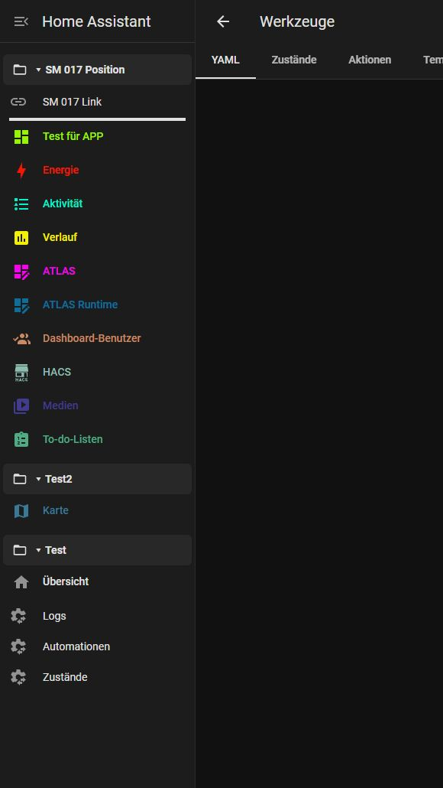
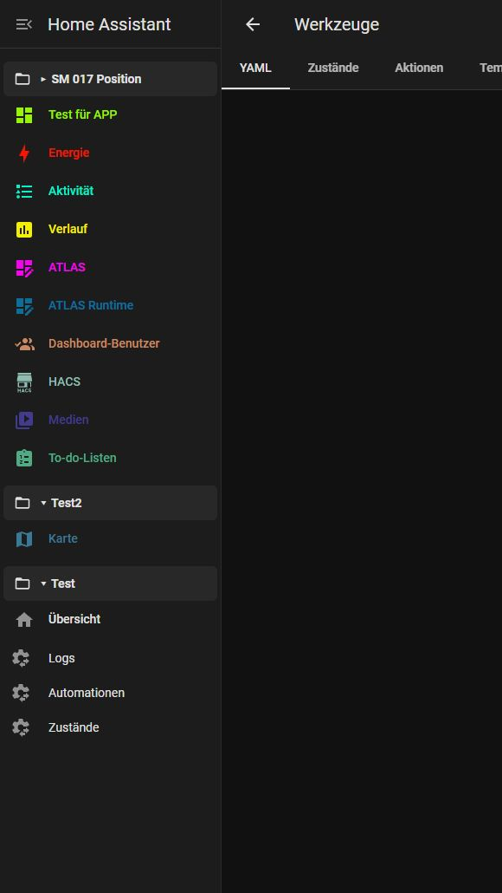
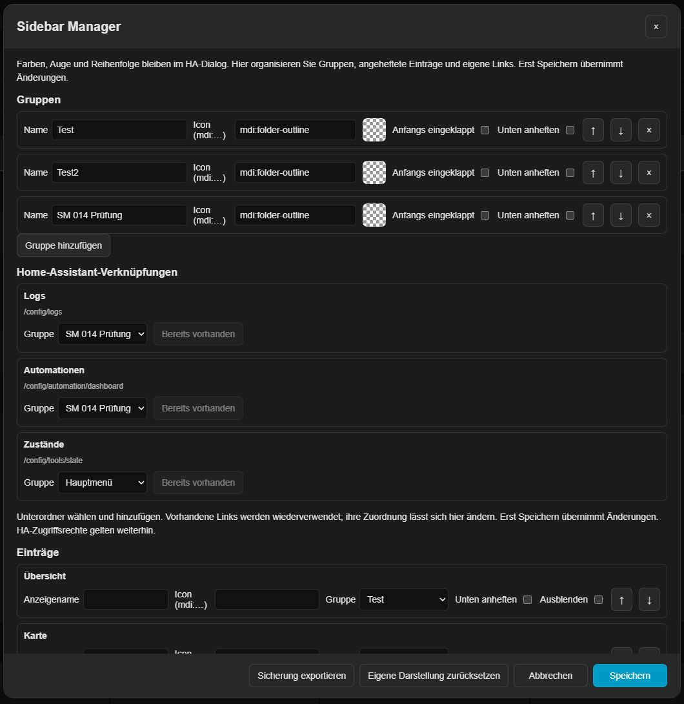
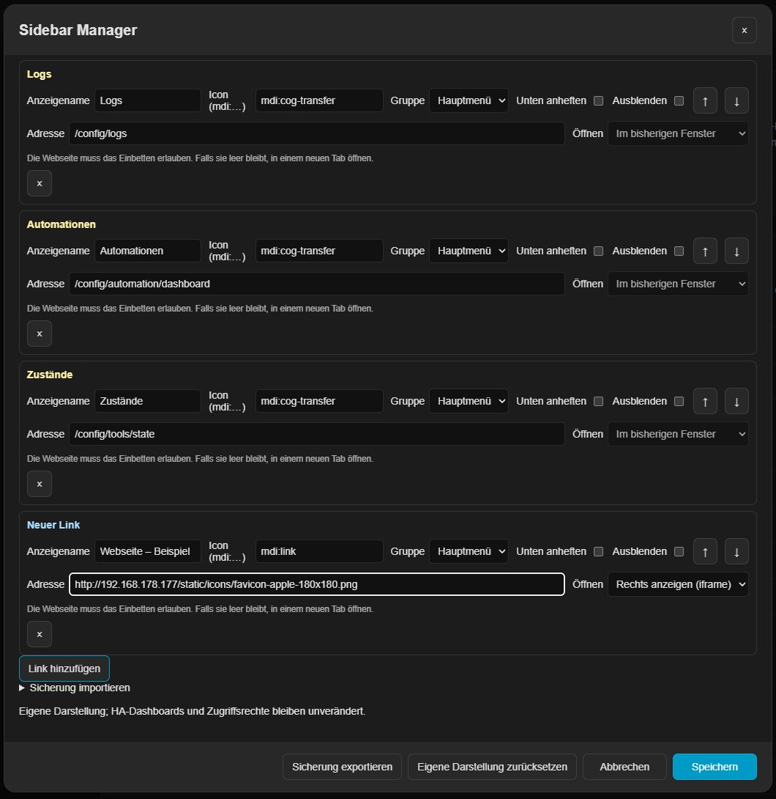
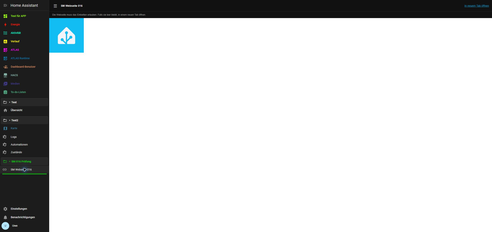

# Sidebar Manager 0.1.7 — aperçu local

Extension indépendante pour Home Assistant : couleurs et opacité, groupes repliables, entrées épinglées, liens personnalisés, noms et icônes MDI. La langue DE/EN/FR suit automatiquement HA. Aucune publication.

0.1.7 vérifiée sur .177 (HA 2026.10.4, port 80) : déplacement d'un dossier de test initialement épinglé en bas, annulation, enregistrement et rechargement. Séparateurs visibles uniquement lorsque le groupe est déplié ; 60 tests automatisés réussis. Réglages et « Test für APP » conservés, objets de test supprimés.

## Utilisation

Maintenez l'en-tête de la barre latérale. Les champs de couleur, les yeux et le tri natifs restent dans « Modifier la barre latérale ». « Gérer les groupes et les liens » ouvre le Manager. Enregistrer dans le Manager applique l'organisation ; les couleurs et l'ordre natif modifiés dans la fenêtre HA doivent être enregistrés séparément dans cette fenêtre. Annuler abandonne le brouillon correspondant.

Chaque groupe possède un nom, un état replié initial et une position basse facultative. Les entrées peuvent être regroupées, renommées pour l'affichage, masquées, épinglées ou dotées d'une icône MDI. Les flèches changent l'ordre dans le Manager. Les en-têtes se replient à la souris, au toucher et au clavier. Les entrées épinglées restent à la fin de la navigation principale défilante, hors de la zone HA réservée au profil et aux notifications. Les liens autorisent les chemins internes et HTTP(S).

Chaque groupe possède un curseur **Séparateur de 0 à 4 px**. Zéro le désactive. La ligne termine le bloc uniquement lorsque le groupe est déplié, avec la couleur et l'opacité de son icône. L'espacement ajouté est limité à 1 px au-dessus et au-dessous. Les groupes vides ou repliés n'affichent aucune ligne.

Dans les réglages, les liens internes personnalisés sont jaune clair et les liens HTTP(S) externes **bleu clair** (`#a8dcff`). Un lien externe peut s'ouvrir **dans un nouvel onglet** ou **à droite dans HA (iframe)**. Les nouveaux liens utilisent initialement un nouvel onglet. Les anciens conservent leur comportement précédent jusqu'à modification. Couleurs personnalisées de la barre latérale et icônes sont conservées.

## Conservation et récupération

Chaque entrée normale affiche son groupe ou « Menu principal » à côté de sa couleur. Un clic ouvre directement son affectation. Choisir un groupe ou « Menu principal » permet de déplacer puis de ramener l'entrée, y compris pour les applications et tableaux de bord existants, sans changer leur destination HA. Chaque groupe dispose d'une icône MDI, un dossier par défaut. Réglages, profil et notifications restent natifs.

Les couleurs existantes restent dans `ugso_sidebar_colors_v1`. L'organisation utilise séparément `ugso_sidebar_manager_v1`, stocké sur le serveur HA par utilisateur et synchronisé entre clients. Les panneaux temporairement absents sont conservés. Une erreur de lecture ou un format inconnu ne remplace jamais les réglages par des valeurs par défaut. Avant chaque écriture, l'organisation précédente est sauvegardée localement ; un stockage bloqué empêche l'enregistrement. Les conflits sont vérifiés avant l'écriture et les confirmations perdues sont contrôlées par relecture. Sans comparaison atomique côté serveur, une course très courte entre écritures simultanées reste possible.

L'export/import JSON couvre l'organisation (groupes, liens, noms, icônes, masquage, épinglage et ordre), sans identifiants ni réglages HA natifs. Les couleurs conservent leur sauvegarde distincte. La réinitialisation affecte seulement le brouillon jusqu'à son enregistrement.

## Installation et retour

Charger un seul module : `/local/ugso-sidebar-manager/0.1.7/ha-sidebar-manager.js`, copié sous `/config/www`. Préserver les thèmes et les autres entrées frontend. Remplacer l'ancien module de couleurs ; ne pas dupliquer la section `frontend`. Valider la configuration, redémarrer HA et recharger le navigateur. Ne pas charger Sidebar Colors ou Sidebar Organizer simultanément.

Pour l'iframe, fusionner aussi l'entrée de **`panel-custom.example.yaml`** dans `configuration.yaml` ou la liste `panel_custom` existante. Elle enregistre le panneau caché `ugso-sidebar-web`, sans nouvelle entrée de barre latérale. Garder la même URL de module que pour le frontend. Valider puis redémarrer HA une fois. Sans cette inscription, un message explique la configuration nécessaire. Le panneau lit uniquement les liens enregistrés de l'utilisateur connecté et ne transmet aucun jeton HA. La page cible doit autoriser l'intégration ; CSP/X-Frame-Options et les restrictions HTTPS-vers-HTTP peuvent l'empêcher. L'ouverture dans un nouvel onglet reste disponible. Un site tiers conserve ses propres exigences de connexion.

Les dossiers possèdent un sélecteur de couleur avec opacité, appliquée à leur icône et leur nom. « Couleur du thème » retire la couleur personnalisée. Enregistrer dans le Manager confirme le choix.

La fenêtre HA « Modifier la barre latérale » réunit tous les sous-menus et les entrées principales. La même poignée native permet de placer chaque dossier entre les entrées principales, sans boutons de déplacement supplémentaires. Le tri au clavier reste disponible (Alt+Haut/Bas sur une ligne). Enregistrer applique l'ordre commun ; Annuler l'abandonne. Les affectations restent intactes : dossier et contenu se déplacent comme un bloc dans la barre latérale. Les dossiers épinglés en bas restent dans cette section. Aucun identifiant de dossier n'entre dans la liste native des panneaux enregistrée par HA.

Depuis 0.1.7, les dossiers épinglés en bas apparaissent aussi en bas dans l'éditeur. Déplacer un tel dossier avant un bloc normal du menu principal retire son épinglage inférieur : la position enregistrée s'applique dans la barre latérale. Annuler conserve la position et l'épinglage d'origine.

Pour revenir, restaurer l'ancien chemin du module sauvegardé et redémarrer HA. Les données Manager restent séparées ; couleurs et réglages natifs sont conservés.

## Limites

Les réglages proposent Journaux, Automatisations et États, avec dossier au choix et `mdi:cog-transfer`. Les liens correspondants sont réutilisés, sans écraser leurs noms ou icônes personnalisés. Enregistrer applique les modifications. États utilise `/config/tools/state` ; les anciens liens `/developer-tools/state` sont reconnus. Les autorisations HA restent inchangées.

Le titre de la section et les trois noms sont jaune clair (`#fff2a6`), y compris dans la liste des entrées plus bas. Cette mise en évidence concerne uniquement les réglages ; les couleurs personnalisées de la barre latérale et les icônes modifiables sont conservées.

La version 0.1.6 est installée et vérifiée sur .177 (HA 2026.10.4, port 80), avec 56 tests automatisés réussis. Nouvel onglet et intégration vérifiés avec une ressource de .177. Ligne de 4 px, opacité correspondante, repli, conservation après rechargement et désactivation vérifiés. Objets de test supprimés ; réglages existants et « Test für APP » conservés. Aucune compatibilité générale avec les sites tiers n'est revendiquée. Voir `TESTING.md`.

Cible minimale HA 2026.10.3 ; vérification réelle uniquement sur .177 avec 2026.10.4. Pas encore d'import YAML Organizer, de présentations par appareil, de CSS libre ou d'actions à modèles. Réglages d'en-tête/largeur et migration automatique Organizer restent à faire. Structure HACS préparée localement, sans publication. Voir `TESTING.md` pour les vérifications.
